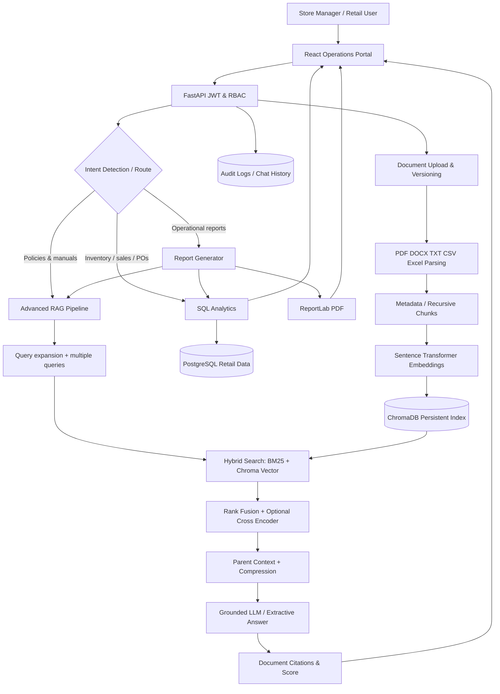

# Architecture — Retail Operations Copilot

## Agentic architecture (no LangGraph)

## Data stores

- PostgreSQL: products, stores, warehouses, inventory, sales, purchase orders, suppliers, customers, promotions, shipments, returns, pricing history, demand forecast, employees, complaints, users, chat, feedback, audit, report metadata.
- ChromaDB: child-chunk vectors plus document name, page, section, and original parent context.
- Persistent file storage: uploads, synthetic sample documents, PDF reports, embedding caches, generated retrieval evaluations.

## Security model

JWT tokens provide user identity and backend-enforced roles. All retail data APIs require authorization. Admin-only operations cover user creation, source deletion and evaluations. The LLM is never allowed to execute arbitrary generated SQL; deterministic SQLAlchemy queries are used for each recognized analytic intent. Documents are untrusted; their text is evidence and not executable instructions.

## Limitations

The system uses bounded RRF ranking and optional cross-encoder reranking. Confidence shown is a relative retrieval score, not model-based certainty. Automatic metadata is derived from upload choices and source formatting; no unsupported page numbers are invented. Public hosting needs proper TLS, secrets, backups, rate limiting, access policies and a cloud account.
