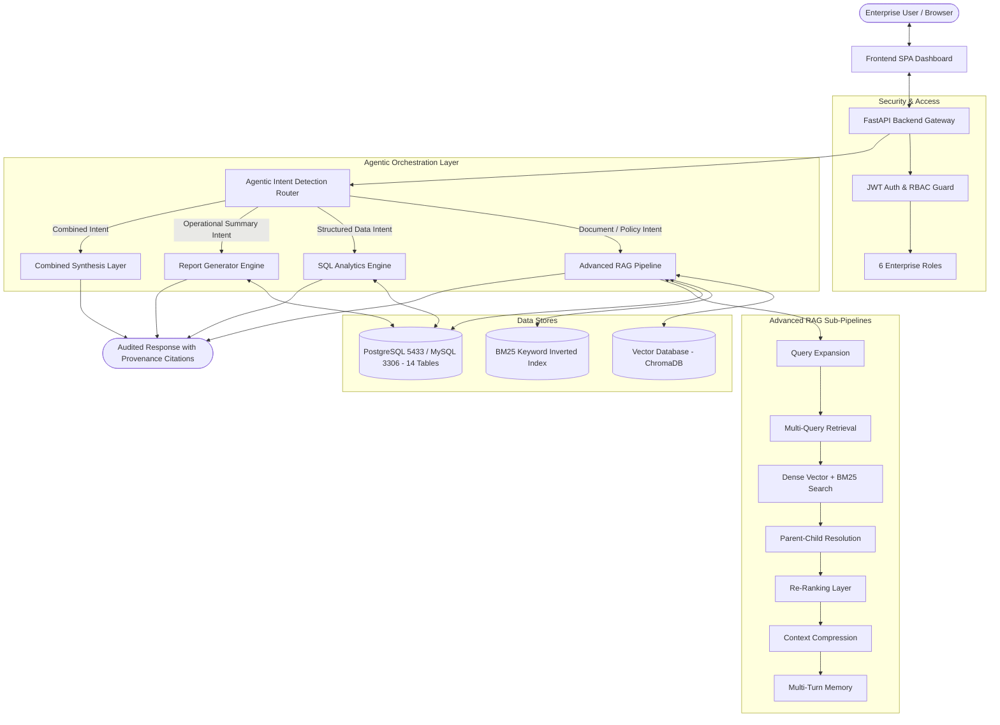

# Architecture Specification: Enterprise AI Retail Operations & Supply Chain Assistant

## 1. System Overview

The **Enterprise AI Retail Operations & Supply Chain Assistant** is a production-grade, full-stack AI platform designed for multi-tier retail enterprises (hypermarkets, supermarkets, and omni-channel retail chains). It integrates structured relational databases, semi-structured document ingestion, and an **Advanced RAG (Retrieval-Augmented Generation)** engine operating under an **Agentic routing architecture without LangGraph**.

---

## 2. Mandatory Advanced RAG Features Breakdown

### 2.1 Document Ingestion & Parsing (5.1)
- Supports multi-format ingestion: **PDF, DOCX, TXT, CSV, and Excel (.xlsx)**.
- Extracted documents are tagged with document type, department, category, and version.

### 2.2 Intelligent Chunking (5.2)
- **Recursive Character Chunking:** Splits text hierarchically using double newlines, headings, periods, and sentence boundaries.
- **Configurable Size & Overlap:** Default 500 characters chunk size with 100 characters overlap.

### 2.3 Query Expansion (5.3)
- Automatically rewrites user queries into multiple semantic and domain-specific search variations.
- *Example:* `"Product out of stock"` expands to `["inventory shortage", "stock availability", "replenishment issue", "warehouse stock level", "inventory allocation"]`.

### 2.4 Multi-Query Retrieval (5.4)
- Executes parallel hybrid retrieval across all expanded query variations.
- Aggregates and deduplicates candidate chunks while maintaining score ranking.

### 2.5 Parent-Child Retrieval (5.5)
- Child chunks (350 characters) are embedded and indexed into the vector database for high-precision matching.
- Upon retrieval, the system resolves the parent document section (1500 characters) from the database to supply complete contextual paragraphs to the LLM.

### 2.6 Metadata Filtering (5.6)
- High-performance filtering across 9 dimensions:
  - Product Category
  - Store Identifier
  - Warehouse Identifier
  - Supplier Identifier
  - Department
  - Region
  - Document Type
  - Date / Period
  - Promotion Campaign

### 2.7 Hybrid Search (5.7)
- Fuses semantic vector embeddings with keyword search using **BM25Okapi**:
  $$\text{Score} = \alpha \cdot \text{VectorScore} + (1 - \alpha) \cdot \text{BM25Score}$$
  where $\alpha = 0.60$.

### 2.8 Re-ranking (5.8)
- Cross-matches query semantic tokens against chunk body and section headings to boost high-relevance chunks before prompt synthesis.

### 2.9 Context Compression (5.9)
- Filters out non-essential sentences while preserving critical facts, numbers, dates, thresholds, and operational rules.

### 2.10 Conversational Memory (5.10)
- Preserves multi-turn conversation sessions. Resolves pronouns (e.g. *"it"*, *"that product"*, *"why is it delayed?"*) using contextual entity tracking.

---

## 3. Agentic Routing Without LangGraph

Instead of relying on heavy graph orchestration frameworks, the system utilizes a fast, deterministic **Intent Detection and Routing Layer**:

1. **RAG Search Route:** Triggered by policy questions, standard operating procedures, manuals, and vendor contracts.
2. **SQL Analytics Route:** Triggered by inventory lookups across warehouses, supplier details, delayed purchase orders, and sales/returns rate analytics.
3. **Report Generator Route:** Triggered by operational reporting requests (Daily Store Reports, Replenishment Checklists).
4. **Combined Analytics & RAG Route:** Triggered by root-cause questions (e.g., *"Why is Product P100 frequently going out of stock?"*), fusing SQL records with SOP citations.

---

## 4. Relational Data Model (14 Structured Tables)

1. `products` (Product Master: ID, category, department, brand, price, supplier, min reorder level)
2. `inventories` (Location type, location ID, quantity on hand, reserved, threshold, safety stock)
3. `sales_transactions` (Transaction ID, store ID, customer ID, product ID, quantity, amount)
4. `purchase_orders` (PO number, supplier ID, destination warehouse, order date, delivery date, status)
5. `suppliers` (Supplier ID, name, email, phone, category, reliability score, lead time)
6. `customers` (Customer ID, name, email, phone, segment, loyalty tier)
7. `promotions` (Campaign ID, category, discount percentage, policy version, status)
8. `stores` (Store ID, name, city, state, region, store type, manager, daily target)
9. `warehouses` (Warehouse ID, name, location, region, capacity, utilization)
10. `shipments` (Shipment ID, PO number, origin, destination, carrier, tracking, status)
11. `returns` (Return ID, transaction ID, product ID, store ID, reason, quantity, refund amount)
12. `pricing_history` (Product ID, old price, new price, effective date, change reason)
13. `demand_forecasts` (Product ID, store ID, forecast date, predicted demand, actual demand)
14. `employees` (Employee ID, name, role, store ID, department, shift, performance rating)

---

## 5. Role-Based Access Control (RBAC)

Enforced via JWT Bearer tokens:
- **Store Manager:** Store daily reports, local replenishment checklists, local inventory lookup.
- **Supply Chain Analyst:** Inter-facility stock transfers, cross-warehouse availability, return rate analytics.
- **Inventory Planner:** Safety stock multipliers, stockout root cause investigation, replenishment matrices.
- **Category Manager:** Pricing guidelines, promotion policy comparisons, brand catalog audits.
- **Procurement Manager:** Vendor agreements, delayed purchase orders, supplier reliability scoring.
- **Administrator:** Full administrative control, document deletion, user creation, benchmark evaluation.
